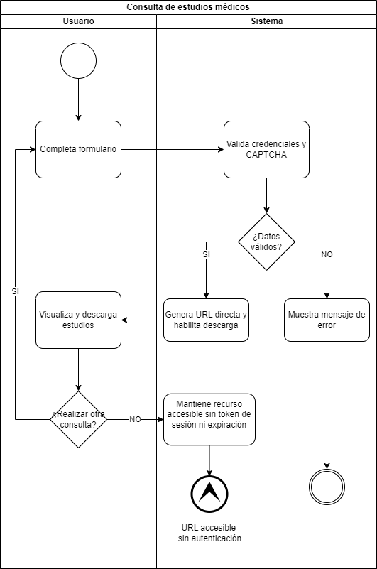
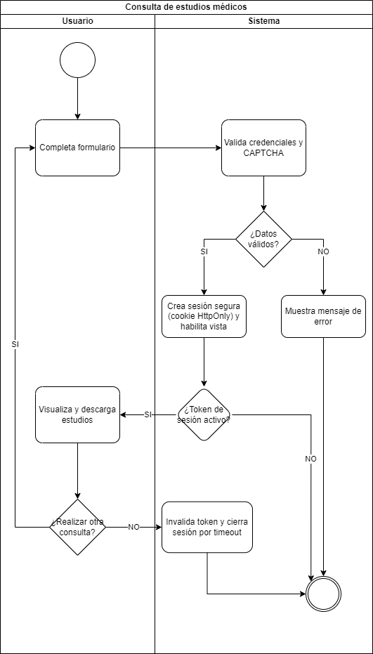

# Análisis de Lógica de Negocio y Control de Acceso en Portales Web (Responsible Disclosure)

Este repositorio documenta la metodología de análisis funcional, pruebas manuales de caja negra y propuesta de mitigación arquitectónica realizada tras detectar una debilidad en la gestión de sesiones de un portal web de consulta de estudios médicos en Argentina (Octubre 2026).

> **Aviso de Divulgación Responsable:** Por motivos de ética profesional y protección de datos sensibles, se han omitido la URL exacta, identificadores internos y nombres de la institución afectada, ya que el reporte fue entregado formalmente al área técnica correspondiente para su evaluación.

## 1. Resumen del Hallazgo
* **Categoría:** Control de Acceso y Gestión de Sesiones (OWASP Broken Access Control).
* **Metodología:** Pruebas manuales de caja negra y análisis de flujo de negocio (sin herramientas automatizadas, limitando las pruebas exclusivamente a datos propios).
* **Comportamiento observado:** Tras superar una validación inicial (documento, número de estudio y CAPTCHA), el sistema generaba una dirección web que permitía visualizar el historial anual de estudios desde ventanas de incógnito o dispositivos distintos sin volver a autenticar la sesión.

## 2. Impacto en el Proceso de Negocio
Aunque el mecanismo inicial buscaba facilitar la consulta rápida al usuario, la ausencia de validación de estado en el servidor rompe el principio de confidencialidad:
1. El enlace consulta directamente los recursos sin verificar si existe una sesión activa asociada al solicitante.
2. Cualquier tercero que obtenga la URL (por historial compartido, redes públicas o capturas) puede acceder a información médica sensible sin superar los controles de identidad.

## 3. Propuesta de Mitigación (Arquitectura TO-BE)
Para resolver la falla manteniendo una buena experiencia de usuario, se propuso un rediseño del flujo de autorización en el Backend:
* **Tokens de sesión efímeros:** Vincular la consulta a una cookie de sesión segura (`HttpOnly`, `Secure`, `SameSite=Strict`) con tiempo de expiración corto.
* **Validación del lado del servidor:** Verificar en cada petición que el usuario autenticado tenga permisos explícitos sobre el recurso solicitado antes de renderizar los datos.
* **Invalidación de enlaces directos:** Evitar parámetros predecibles o persistentes en la URL que funcionen como llave de acceso permanente.

## 4. Modelado de Procesos (BPMN)

### Flujo Actual (AS-IS)

### Flujo Mitigado (TO-BE)

## 5. Habilidades Aplicadas
* Análisis de lógica de negocio y procesos de autenticación.
* Documentación técnica formal orientada a equipos de desarrollo y gestión.
* Pruebas funcionales y de seguridad de caja negra.
 
